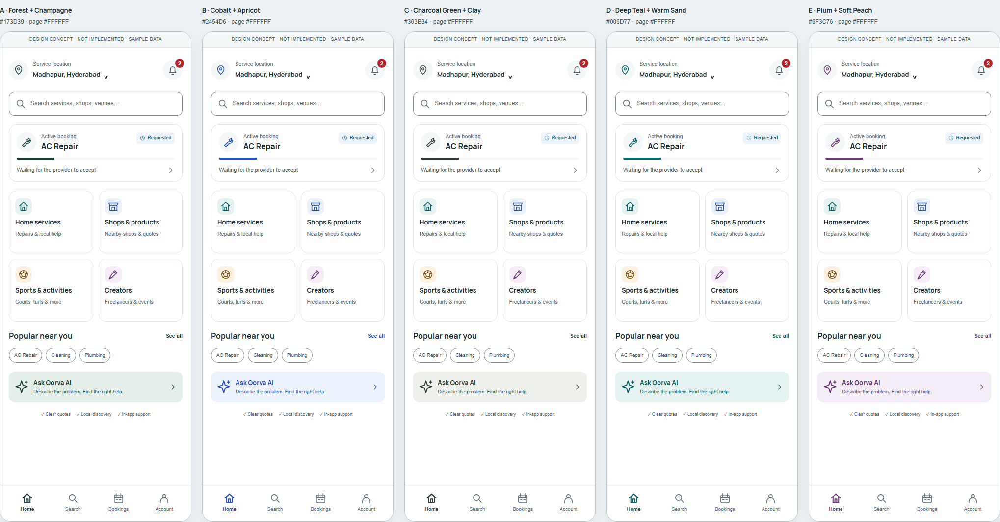
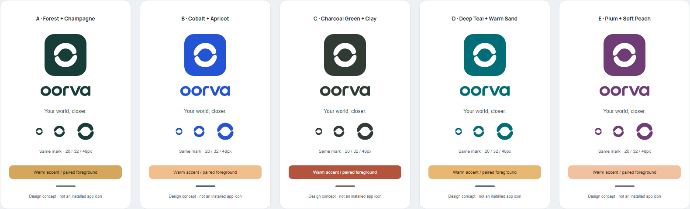
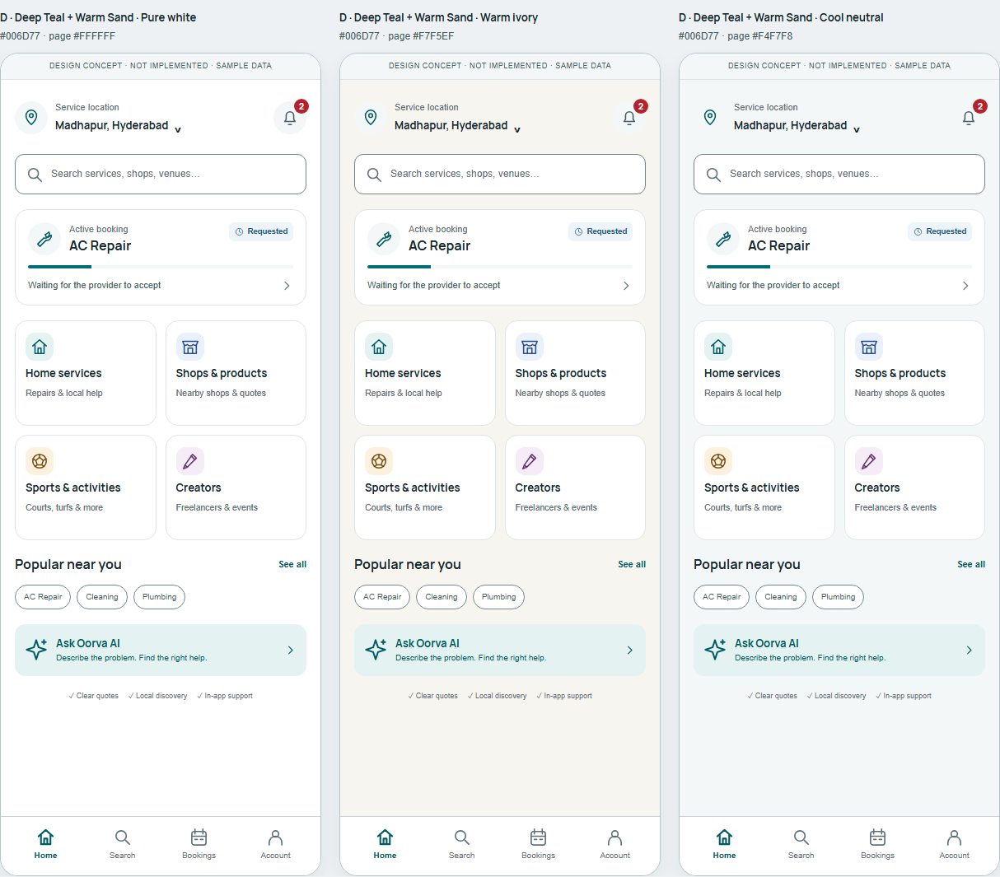
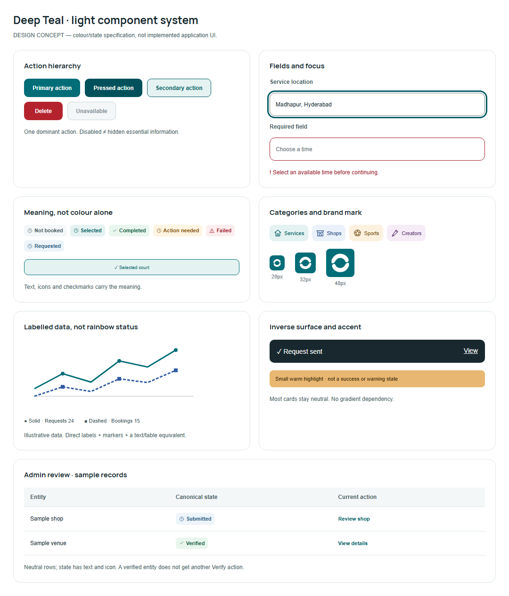

# Oorva — Colour Exploration and Final Design-Token Recommendation

| Field | Result |
|---|---|
| Scope | Completed planning/design exploration. **No application, database, runtime switch, installed asset or existing implementation-plan change.** |
| Source baseline | `128c9595472b92589ff5407246df1aadde4dc7cb`, inspected November 23, 2026; snapshot of actual current source, not a claim every source screen was run. |
| Brief | Colours document `15vk-anmnAsYjYWWAOg-2Ze27fhM8MmxrOmY3VYhZZWc`; complete 164-line export SHA256 `00E4C800BCC1EB8A4DF61AEAAE6930110F136F411374BD8515D544642D3CEAC8`. |
| Evidence | Five controlled directions; 30 light screen concepts; 6 recommended dark counterparts; 46 PNG assets including comparison/identity/background/component boards; 9 official benchmark entries; 312 specified contrast checks. |
| Decision | **D — Deep Teal + Warm Sand on pure white.** Design recommendation is final for this study; owner acceptance still gates replacing the application colour contract. |
| Approval authority | Project owner. User research, trademark clearance and production/native release are not established by this study. |

## Summary

**Use deep teal `#006D77`, white `#FFFFFF` and a small warm-sand accent `#E8B772`.** Keep most cards neutral. Use dark ink `#18282E` for content, semantic green only for success, and labelled category accents in small icon areas. The identity works without gradients, fully coloured cards or an ivory page.

Teal provides a stronger chromatic action cue than charcoal/forest in the controlled screens, while avoiding a return to the sampled mainstream blue identity. The warm accent adds recognition without becoming a second primary action. This is a design judgment from the comparisons—not a measured trust, cultural-preference or conversion effect.

Cobalt is a credible runner-up, not a rejected colour. Its 85/100 versus teal's 87/100 is a close subjective result; the recommendation rests on the coherent cross-screen treatment and mark, not statistical precision.

### Open the deliverables

- [Interactive offline comparison viewer](design/oorva/colours/index.html): download/open locally; GitHub does not execute repository HTML in its file viewer.
- [Home comparison](design/oorva/colours/compare-home.png), [service listing](design/oorva/colours/compare-service.png), [sports venue](design/oorva/colours/compare-sports.png).
- [Provider workspace](design/oorva/colours/compare-merchant.png), [shop-owner workspace](design/oorva/colours/compare-shop.png), [AI assistant](design/oorva/colours/compare-ai.png).
- [Mark/accent comparison](design/oorva/colours/compare-identity.png), [white/ivory/neutral comparison](design/oorva/colours/compare-backgrounds.png).
- [Recommended light component/admin system](design/oorva/colours/recommended-components-light.png), [dark companion](design/oorva/colours/recommended-components-dark.png).
- [Complete design tokens](design/oorva/colours/design-tokens.json), [all five palettes and 50 score rationales](design/oorva/colours/palettes.json), [contrast results](design/oorva/colours/contrast-results.json).

## 1. Controlled comparison and actual product context

The concepts are **source-informed static reconstructions**, not running application screenshots or a claim that the redesign is implemented. Home keeps location → search → active booking → four category cards → popular services → AI → bottom navigation. The same samples, DOM, fonts, icon geometry, dimensions, section order and interaction representations are held fixed across A–E; only the identity roles change. Browser geometry/text comparisons passed for every corresponding node across six screens.

| Screen | Existing source inspected | Comparison boundary |
|---|---|---|
| Home | `app\src\features\home\HomeV2.tsx:135-165,189-295,341-430` | Current populated home structure, same four pillars and popular/AI placement in every direction; no palette gets a better layout. |
| Service listing | `app\src\components\ProviderCard.tsx:82-129` | Same provider metadata/card and separate booking CTA; synthetic samples, not live verification/availability. |
| Sports venue | `app\src\features\sports\SportsVenueBookingScreen.tsx:223-365` | Venue/illustration, resource/date/slot and footer; selection/unavailable text stays identical. |
| Provider business | `app\src\features\providerDashboard\ProviderDashboardView.tsx:82-210` | Availability, staff, stats, request and next-work sections; absent optional inbox modules are not rendered in this sample. |
| Shop owner | `app\src\features\marketplaceScreens\MerchantShopScreen.tsx:415-477` | Actual identity/form/save/catalogue/enquiry/RFQ hierarchy, with a condensed representative form; no new shop dashboard/checkout engine. |
| AI | `app\app\assistant.tsx:1` → `app\src\features\platformScreens\AssistantScreen.tsx:625-748` | Header/location/messages/advisory draft/footer; AI does not confirm bookings. |
| Current colour candidate | `app\src\branding\defaults.ts:41-169`; doc 18 A.1.1–A.1.2 | Existing forest/ivory is the comparison baseline, not an assumed winner. All 59 proposed theme keys match existing colour-role keys. |

The 390 × 1000 tall comparison canvas presents the same content for review; it is not an exact device-viewport or production-fit claim. Manrope 600/700 headings use the existing licensed font. Arial/Segoe UI body is held fixed in the standalone study; production Inter and doc 18 typography are unchanged. The court is an original labelled illustration. Names, ratings, stock, prices and bookings are synthetic, with a visible **not implemented** banner on every screen.

## 2. Five genuinely different directions

| ID | Direction | Primary / pressed / soft | Secondary / accent | Character and trade-off |
|---|---|---|---|---|
| A | Forest + Champagne | `#173D39` / `#102D2A` / `#E4EFE9` | `#617D6D` / `#D5A65B` | Quiet, traditional premium. Tests the existing direction fairly on white, without assuming forest/ivory must win. |
| B | Cobalt + Apricot | `#2454D6` / `#193FA8` / `#EDF2FF` | `#465E84` / `#F1BE8D` | Direct, energetic consumer technology. A real blue contender: familiar existing interaction language, not disqualified because the old app uses blue. |
| C | Charcoal Green + Clay | `#303B34` / `#202A23` / `#EDF0EB` | `#7A6658` / `#B4543C` | Editorial, practical and warm. An almost-neutral identity with a terracotta accent, rather than a second saturated forest swatch. |
| D | Deep Teal + Warm Sand | `#006D77` / `#00515B` / `#E4F2F1` | `#526983` / `#E8B772` | Clear, composed and approachable. A chromatic action cue that is separate from semantic success green, with restrained warm recognition. |
| E | Plum + Soft Peach | `#6F3C76` / `#54285C` / `#F4ECF6` | `#756381` / `#F2C2A0` | Expressive, distinctive and creative. An original non-green/non-blue challenger that stress-tests creative identity against utilitarian operations. |

A is the forest/champagne challenger; B uses a much brighter cobalt; C is a near-neutral charcoal/clay identity rather than a second saturated forest; D uses deep cyan-teal; E is a plum/peach challenger. Secondary/accent treatments are shown on the identical mark board, not smuggled into status colours or filled across every card.

## 3. White versus ivory versus neutral

| Background | Controlled visual finding | Decision |
|---|---|---|
| Pure white `#FFFFFF` | Cleanest continuity between header, search, cards and navigation in this study. White cards still need spacing and a decorative border; actual input/focus boundaries use stronger dedicated roles. | **Default light-page background and normal surface.** |
| Warm ivory `#F7F5EF` | More obvious white-card separation and a warmer editorial character; the entire canvas adds a warm cast that is not needed for Oorva's recognition. | Do not use as the global page default. Reserve warmth for the small sand accent. |
| Cool neutral `#F4F7F8` | Clear grouping in forms/admin views, but a full-page grey treatment makes browsing more container-heavy. | Keep as `surfaceAlt`, disabled/decorative/group containers—not every page. |

This experiment holds the chosen teal, white cards, layout, labels and all status/category colours constant. It changes **only** page background, so the white decision is not confounded by different content or spacing. All three background/text combinations have explicit contrast checks.

## 4. Industry benchmark: observable patterns, not copied branding

Sources checked November 23, 2026. Store screenshots are vendor-authored public promotional material, not authenticated native-app audits. The principles below are interpretations of those materials; exact competitor palette values are included only where a published guide states them.

| ID / product | Directly observable pattern | Principle for Oorva | Do not copy / evidence limit |
|---|---|---|---|
| B01 · Urban Company | Developer promotional screens use light surfaces with a purple booking control; the mark is black and white. Service categories use labels and imagery. | Keep browsing surfaces quiet and make the current booking action unmistakable. | Do not copy the purple, mark, layout, service imagery or icons. Promotional imagery does not establish every current screen, region or native state. |
| B02 · Swiggy | The publicly hosted guide names orange #FF5200, white #FFFFFF and pale Salt #FFEDE3. Promotional slides distinguish services with contextual colour families. | Separate recognition colour, action roles and product/category accents. | Do not borrow the orange identity, sub-brand graphics or promotional composition. Guide metadata indicates creation in 2025; latest revision and authenticated app implementation were not established. |
| B03 · Blinkit | Public promotional material combines yellow, black and green; a light support panel uses green links. | Brand expression need not be the same as every functional accent. | Do not copy the yellow-green mark, graphics or make category/status meaning depend on the brand hue. Purchase-action colour and authenticated checkout were not verified. |
| B04 · Airbnb | Official release examples and store promotion show a pink-red mark, light booking views, labelled photographic categories, and context-specific pink or dark actions. | Test action emphasis across booking contexts; keep content and category labels legible. | Do not clone the mark, booking composition, photography or signature colour treatment. Release illustrations/store promotion are not an audit of every live native booking state. |
| B05 · Uber | Developer promotion frames light product views with black-and-white branding and contextual green/gold. Separate Uber Direct collateral illustrates a dark action. | One neutral product base can support multiple service contexts without recolouring every card. | Do not reuse the mark, membership/grocery palette, promotional frames or graphics. Rider promotional views and merchant collateral are distinct contexts; current rider checkout was not audited. |
| B06 · Apple HIG | Published guidance uses dynamic foreground/background roles and appearance variants; accents emphasize controls and colour needs supporting meaning. | Specify paired light/dark roles and retain text/symbol cues. | Do not assume copying platform colour values creates a distinctive consumer brand. Platform guidance, not competitor marketplace research or a prescription to force dark mode. |
| B07 · Material / Android | Official guidance distinguishes accent, semantic and surface roles with paired container/foreground colours and light/dark schemes. | Evaluate real foreground/background usage pairs, not isolated brand swatches. | Do not copy a sample palette or invent category colours from a generic system. General platform guidance; no particular marketplace/category hues are prescribed. |
| B08 · Shopify merchant guidance | Merchant-admin guidance reserves colours for state, uses neutral text/category chips, and illustrates a dark action on a light card. | Keep merchant/admin pages neutral; distinguish category decoration from status. | Do not import Shopify-specific status meanings or copy its exact interface. Merchant-admin design context, not a universal consumer-app colour policy. |
| B09 · Booking.com | Vendor-published store images show blue promotional framing, a white booking card and a blue outlined Select room action; product photography remains content rather than page decoration. | Treat blue as a credible booking/action direction and keep product surfaces legible; brand distinctiveness still needs Oorva's own mark and composition. | Do not copy the logo, photography, promotional layout, rewards or discount claims. Two official developer promotional images inspected; these do not establish current authenticated checkout or all blue values. |

The defensible common lesson is **neutral content surfaces + clear action hierarchy + semantic colour roles**, not “every successful app is blue/green” or “Indian users prefer a particular hue.” Oorva keeps its own mark and proportions. No competitor screenshot, code, icon, photograph or branded artwork is included in the concepts.

## 5. Scoring and decisive selection

Each criterion is 1–10, equally weighted, total/100. These are expert design judgments, not sampled user measurements. “Indian relevance” means suitability for a diverse multilingual local-marketplace context without stereotyped styling; it is **not proven cultural preference**. All directions must pass the same contrast gate, so colour taste cannot buy a higher accessibility score.

| Criterion | A Forest | B Cobalt | C Charcoal | D Teal | E Plum |
|---|---|---|---|---|---|
| Brand distinctiveness | 8 | 6 | 8 | 8 | 9 |
| Trust and credibility | 9 | 9 | 8 | 9 | 7 |
| Premium appearance | 9 | 8 | 9 | 8 | 9 |
| Friendliness and accessibility | 7 | 9 | 8 | 9 | 8 |
| Indian consumer relevance | 8 | 9 | 8 | 8 | 7 |
| Multi-category suitability | 8 | 9 | 7 | 9 | 8 |
| Scalability across roles | 8 | 9 | 7 | 9 | 8 |
| App-icon recognizability | 8 | 8 | 8 | 9 | 9 |
| Accessibility and contrast | 9 | 9 | 9 | 9 | 9 |
| Long-term sustainability | 8 | 9 | 8 | 9 | 8 |
| **Total /100** | **82** | **85** | **80** | **87** | **82** |

### Reason for every score

| Criterion | A Forest | B Cobalt | C Charcoal | D Teal | E Plum |
|---|---|---|---|---|---|
| Brand distinctiveness | 8: Clear contrast with the blue/orange examples; colour alone does not establish uniqueness. | 6: Very close to established blue interaction language in the sampled market. | 8: Unusual neutral-led marketplace identity, especially with clay. | 8: A clear teal silhouette in the bounded benchmark, not a uniqueness/trademark claim. | 9: Most visibly different challenger in this set; not a trademark clearance. |
| Trust and credibility | 9: Strong dark labels and conservative controls; judgment, not tested trust. | 9: Familiar high-contrast controls with no need to change interaction conventions. | 8: Serious and restrained; can feel heavier in operational tables. | 9: Clear action/state separation and clean neutral surfaces. | 7: Readable, but expressive tone is less neutral for refunds/admin work. |
| Premium appearance | 9: Strongest restrained forest/sand combination in the static review. | 8: Crisp but less differentiated from mainstream consumer apps. | 9: Editorial warmth and low chroma support a refined appearance. | 8: Clean without needing ivory, dark surfaces or metallic effects. | 9: Refined depth with controlled peach; overuse would look boutique. |
| Friendliness and accessibility | 7: Dark action can feel more formal; light surfaces soften it. | 9: High visibility and familiar control rhythm. | 8: Clay warms the neutral but charcoal actions feel substantial. | 9: Softer chromatic character without weakening text or action contrast. | 8: Peach is welcoming; plum must remain restrained. |
| Indian consumer relevance | 8: No religious, regional or premium-only visual references. | 9: Fits familiar sampled consumer conventions; preference is untested. | 8: Warm without claiming a traditional/craft identity. | 8: Neutral across languages, categories and regions; field preference untested. | 7: Needs broader testing to exclude a beauty/creator-only interpretation. |
| Multi-category suitability | 8: Works broadly, but brand and green completion are relatively close. | 9: Broadly neutral across shopping/services/sports/creative work. | 7: Strong in services/shop work; less expressive for AI/sports. | 9: Primary works independently of four restrained category accents. | 8: Creative strength is clear; service/admin balance needs discipline. |
| Scalability across roles | 8: Dense operational tables remain readable; green status distinction needs care. | 9: Consumer and admin views remain clear and conventional. | 7: Dense pages are legible, but neutral actions can dominate. | 9: All six reconstructed views remain coherent without coloured cards. | 8: Dense merchant view works, but emotional emphasis is stronger. |
| App-icon recognizability | 8: Connected mark remains clear on dark forest. | 8: Clear mark, but blue icon field is common in bounded sample. | 8: Strong silhouette, less colour-led differentiation. | 9: Clear white mark at 20 / 32 / 48 px on distinctive chromatic field. | 9: Very clear peach/white contrast direction and recognizable silhouette. |
| Accessibility and contrast | 9: All prescribed used pairs pass the same numerical gate. | 9: All prescribed used pairs pass the same numerical gate. | 9: All prescribed used pairs pass the same numerical gate. | 9: All prescribed used pairs pass the same numerical gate. | 9: All prescribed used pairs pass the same numerical gate. |
| Long-term sustainability | 8: Simple and durable; gold should not become an offer/status dependency. | 9: Simple semantic scaling; recognition depends more heavily on mark/content. | 8: Durable neutral base; warm accent needs careful allocation. | 9: Clear separation of brand, surfaces, semantic status and categories. | 8: Durable if restrained, but strongest association risk in this review. |

**Select D.** Its teal action remains legible in discovery, booking, owner forms and AI; success remains explicitly green, while warning/error retain their own meanings. White prevents the product from becoming a heavy “premium” shell. The same Connected O silhouette at 20 / 32 / 48 px, teal action/nav rhythm, neutral layout and small warm accent form the recognition system. Category identity is local and labelled, not four separate app themes.

**Why not the alternatives:** A has excellent contrast and restraint, but its more formal forest/sand association is weaker for the friendly everyday product in this comparison. B is clean and practical, but offers less separation from familiar blue consumer interfaces in the benchmark. C is refined yet action-heavy/near-neutral in busy workspaces. E stands out most, but its expressive character is harder to keep neutral across service operations, payments and admin. These are bounded design interpretations, not causal user findings.

## 6. Complete centralized colour specification

The machine-readable authority for this **recommended design** is [design-tokens.json](design/oorva/colours/design-tokens.json). It provides all 59 existing colour keys for light and dark plus explicit component, badge, chart and state mappings. Do not select additional hex values while implementing an approved adoption.

### Requested brand/content roles

| Requested role | Light value | Existing role / rule |
|---|---|---|
| Primary brand | `#006D77` | `primary` |
| Primary dark / pressed | `#00515B` | `primaryPressed` |
| Primary light | `#E4F2F1` | `primarySoft` |
| Secondary brand | `#526983` | `secondary`; restrained decoration, not a second CTA |
| Background / normal surface / elevated surface | `#FFFFFF` / `#FFFFFF` / `#FFFFFF` | `bg`, `surface`, `surfaceRaised`; elevation uses grouping/border, not a coloured card |
| Primary / secondary content text | `#18282E` / `#465C64` | `text`, `textSecondary`; existing `primaryText` means brand-link foreground, **not** primary body text |
| Supporting / disabled text | `#5F7077` / `#849197` | `muted` readable; `subtle` inactive/decorative only |
| Border / divider | `#DEE5E7` | Decorative `border`; not the sole input boundary |
| Input outline | `#74848B` | `outline`; meaningful boundary |
| Primary button | `#006D77` + `#FFFFFF` label | `primary` + `onPrimary`; pressed `#00515B` |
| Secondary button | `#E4F2F1` + `#005B63` label/outline | `primarySoft` + `primaryText` |
| Selected state | `#E4F2F1` + `#005B63`, outline `#006D77` | Add a checkmark and programmatic selection |
| Focus state | `#005B63`, 3 px ring, 2 px surface gap | Dedicated ring around actual control, not a colour-only fill change |
| Success / warning / error / information text | `#15613B` / `#87500A` / `#A51D27` / `#245A85` | Paired containers below; always add icon/text |
| Warm recognition accent | `#E8B772` + `#3D2B0D` label | `accent` + `onAccent`; not warnings, not every card |

### Exact light and dark values

Retain the OS-selected dark companion because the existing app supports dark appearance; do not make dark the default brand experience or override system preference. Use `defaultTheme=system`, white when light, and the following explicit dark values. Do not invert colours automatically.

| Existing colour key | Light | Dark |
|---|---|---|
| `bg` | `#FFFFFF` | `#0C1B21` |
| `surface` | `#FFFFFF` | `#14262D` |
| `surfaceAlt` | `#F4F7F8` | `#1B3138` |
| `surfaceRaised` | `#FFFFFF` | `#20383F` |
| `surfaceOverlay` | `#FFFFFF` | `#20383F` |
| `text` | `#18282E` | `#EAF4F6` |
| `textSecondary` | `#465C64` | `#C0D3D7` |
| `muted` | `#5F7077` | `#A0B7BE` |
| `subtle` | `#849197` | `#728B94` |
| `border` | `#DEE5E7` | `#2E4850` |
| `borderStrong` | `#C9D3D7` | `#48656D` |
| `outline` | `#74848B` | `#76939D` |
| `success` | `#1C7B4B` | `#88DAB0` |
| `successStrong` | `#15613B` | `#88DAB0` |
| `successText` | `#15613B` | `#B2EACB` |
| `successSoft` | `#E9F6EE` | `#18392A` |
| `warning` | `#A96111` | `#F4C56F` |
| `warningText` | `#87500A` | `#F8D593` |
| `warningSoft` | `#FFF4E1` | `#3C301C` |
| `danger` | `#BA3F3F` | `#FFB3B7` |
| `dangerStrong` | `#B4232D` | `#B4232D` |
| `dangerPressed` | `#8F1D27` | `#8F1D27` |
| `onDanger` | `#FFFFFF` | `#FFFFFF` |
| `dangerText` | `#A51D27` | `#FFB3B7` |
| `dangerSoft` | `#FDEDEE` | `#402128` |
| `info` | `#2D6596` | `#8BC3EE` |
| `infoText` | `#245A85` | `#B0D7F6` |
| `infoSoft` | `#EDF4FA` | `#1C354A` |
| `star` | `#865514` | `#F4C56F` |
| `skeleton` | `#E7EDEF` | `#29434C` |
| `onInverse` | `#FFFFFF` | `#FFFFFF` |
| `onHero` | `#FFFFFF` | `#FFFFFF` |
| `catHome` | `#006D77` | `#80D4D4` |
| `catHomeText` | `#005B63` | `#A5E6E4` |
| `catHomeSoft` | `#E4F2F1` | `#163D44` |
| `catShops` | `#315CA4` | `#A0C2FF` |
| `catShopsText` | `#264C8B` | `#BDD4FF` |
| `catShopsSoft` | `#EBF1FA` | `#1B3155` |
| `catSports` | `#865514` | `#EBC482` |
| `catSportsText` | `#795014` | `#F2D59E` |
| `catSportsSoft` | `#FCF1DF` | `#3C301C` |
| `catCreators` | `#754185` | `#D5ADE2` |
| `catCreatorsText` | `#663674` | `#E3C5ED` |
| `catCreatorsSoft` | `#F5ECF8` | `#382340` |
| `toastBg` | `#18282E` | `#18282E` |
| `toastBorder` | `#18282E` | `#48656D` |
| `segmentThumb` | `#FFFFFF` | `#20383F` |
| `primary` | `#006D77` | `#80D4D4` |
| `primaryPressed` | `#00515B` | `#A0E4E2` |
| `primarySoft` | `#E4F2F1` | `#163D44` |
| `primaryText` | `#005B63` | `#9BE1E0` |
| `onPrimary` | `#FFFFFF` | `#003B42` |
| `secondary` | `#526983` | `#B7C9E0` |
| `accent` | `#E8B772` | `#F1C482` |
| `onAccent` | `#3D2B0D` | `#3D2B0D` |
| `heroFrom` | `#006D77` | `#006D77` |
| `heroTo` | `#00515B` | `#00515B` |
| `bubbleMine` | `#006D77` | `#80D4D4` |
| `bubbleTheirs` | `#E4F2F1` | `#1B3138` |

### Component and state mappings

| Component | Exact role pair / state |
|---|---|
| Primary / pressed CTA | `primary`/`primaryPressed` + `onPrimary` |
| Secondary CTA | `primarySoft` + `primaryText`; outline `primaryText` |
| Outline CTA / input | `surface` + `text`; border `outline`; placeholder `muted` |
| Destructive / pressed | `dangerStrong`/`dangerPressed` + `onDanger`; never pastel `dangerText` as fill |
| Unread count | `dangerStrong` + `onDanger`, numeric label |
| Disabled | `surfaceAlt` + `subtle`; visibly inactive, no essential information only in disabled text |
| Own / other chat | `bubbleMine` + `onPrimary`; `bubbleTheirs` + `text` |
| Toast | `toastBg` + `onInverse`; underlined action and status icon/text |
| Focus | `primaryText`, 3 px ring, 2 px gap matching adjacent `surface`; keep visible on custom surfaces |

Badges: neutral=`surfaceAlt/textSecondary`; selected=`primarySoft/primaryText`; completed=`successSoft/successText`+check; action-needed=`warningSoft/warningText`+clock; failed=`dangerSoft/dangerText`+alert; requested=`infoSoft/infoText`+clock. Do not use the semantic status name to invent a backend transition.

Category accents are the exact `catHome*`, `catShops*`, `catSports*`, `catCreators*` rows: small labelled icon roundels only. A category is not a success/error status. Most cards remain white/neutral.

Charts use the six exact light/dark series in `design-tokens.json.charts`, with direct text labels, values, distinct markers/dashes and 2 px surface separators. Status charts use semantic status roles. Do not claim arbitrary adjacent series are colourblind-distinguishable; provide a text/table equivalent and test the actual chart.

## 7. Measured accessibility and visual verification

W1 requires 4.5:1 for normal text and 3:1 for qualifying large text, subject to its stated exceptions. This study applies 4.5:1 to all tested readable text pairs. W2 supplies the 3:1 meaningful boundary/graphic rule. W3 requires a visible cue beyond colour where colour carries meaning. Ratios are calculated from the specified colours; pass/fail uses unrounded values, not screenshot antialiasing.

| Check | Result |
|---|---|
| Readable semantic text / action / badge / chat / inverse / category pairs; meaningful input/focus/chart cues; background experiment | **312/312 specified pairs pass**; [full values](design/oorva/colours/contrast-results.json). |
| White on primary teal | **6.08:1** |
| White on pressed teal | **9.02:1** |
| Supporting text on white | **5.16:1** |
| Selected label on selected container | **6.83:1** |
| White on destructive fill | **6.52:1** |
| Comparison integrity | Identical text/geometry at corresponding nodes across all 5 directions for each of 6 screens; no alternative gets extra space or better content. |
| Browser-computed text pairs | Independent static-view verification also checks every visible non-disabled, non-SVG text foreground against its actual computed background across the study. See the [complete verification result](design/oorva/colours/study-validation.json); this remains a bounded static check, not full accessibility conformance. |
| Rendered deliverables | 46 decodable PNGs; hashes/dimensions recorded; local viewer tabs tested; no runtime network requests or JavaScript errors. |
| Visual inspection | All 6 light comparison boards, mark/accent/background boards, component boards and recommended dark home inspected; retained white cards and explicit state labels. |

Decorative dividers and inactive content are explicitly excluded from readable-text claims. This is **not full WCAG conformance**, an interaction accessibility audit, a colour-vision user test or production/device validation. Production 320-width, 200% text, Telugu/mixed-script, keyboard/focus, dark/custom-theme and screen-reader testing remains required. Do not copy the compact concept CSS as the production typography/layout specification.

## 8. Implementation handoff and concurrent-work boundary

This report proposes **colour values, not application implementation**. [Doc18](18-Oorva-Transformation-Implementation-Plan.md) and its existing execution allocation remain unchanged until the owner accepts this recommendation. Current-main brand defaults already contain forest; that does not make forest the outcome of this independent study.

1. Record owner acceptance of **D / white + exact JSON version/hash**; do not silently infer public/native identity approval. Keep independent correctness/permission/money work moving.
2. On the active implementation base, route the approved colour adoption to the current owners of `branding/defaults.ts`, `colorContract.ts`, strict fixtures and `theme/tokens.ts`. Preserve any newer fixes and exact feature/parent/OFF contracts. Do not create another theme engine.
3. Map `light`/`dark` to their 59 existing Palette keys. `components`, `badges` and `charts` are bundled design-role mappings, **not extra fields to upload into strict BrandingV1**. Update exact contrast/validation expectations together; invalid appearance must never stop live OFF controls.
4. Apply values through central roles and existing components; no route-level hex overrides. Preserve doc 18 production typography, spacing, essential text reflow, controller/RPC/state/money behaviour and historical data.
5. Re-export approved identity/native artwork with the selected colours while retaining the mark geometry. Installed icons/splash and native distribution retain their own gates; runtime settings cannot undo installed assets.
6. Run targeted authorized implementation checks for light/dark/custom/invalid/rollback, brand/family OFF and parent-OFF, actual used colour pairs, keyboard/focus,320-width / 200% text and real native frames. Only then consider explicitly approved activation.

## 9. Risks, decisions and not verified

| Item | Exact boundary |
|---|---|
| Palette selection | D is the study's decisive recommendation, not automatic production activation. |
| Competitor evidence | Official public materials; not a current authenticated app audit or evidence that a specific hue causes trust/conversion. |
| Cultural relevance | No Indian consumer preference study; no stereotypes, religious cues or demographic inference used. |
| Distinctiveness | Relative design judgment within a bounded benchmark; no trademark/uniqueness clearance. |
| UI fidelity | Source-informed reconstructions and condensed samples, not running/captured application screens; all concepts explicitly labelled. |
| Typography/device | Existing heading font and constant study body; production Inter/Telugu/native/200% rendering not validated by these static PNGs. |
| App/runtime | No app/source/theme/flags/SQL/native asset or doc 18/execution-plan change. Concurrent untracked venue work remains untouched. |
| Financial/product claims | Synthetic data only; no new availability, verified identity, stock, price, checkout, refund or bank-settlement assertion. |

## References

- [Colour strategy brief](https://docs.google.com/document/d/15vk-anmnAsYjYWWAOg-2Ze27fhM8MmxrOmY3VYhZZWc/edit)
- [Complete benchmark/source records](design/oorva/colours/benchmark-sources.json)
- [Source and reconstruction provenance](design/oorva/colours/provenance.json)
- [Render validation and image hashes](design/oorva/colours/render-validation.json)
- [B01 · Urban Company](https://www.urbancompany.com/)
- [B01 · Urban Company developer listing](https://play.google.com/store/apps/details?id=com.urbanclap.urbanclap&hl=en-US)
- [B02 · Masterbrand Internal Guidelines, pages 21 and 24](https://www.swiggy.com/corporate/wp-content/uploads/2026/06/Masterbrand-Internal-Guidelines.pdf)
- [B02 · Swiggy developer listing](https://play.google.com/store/apps/details?id=in.swiggy.android&hl=en-US)
- [B03 · Blinkit](https://blinkit.com/)
- [B03 · Blinkit developer listing](https://play.google.com/store/apps/details?id=com.grofers.customerapp&hl=en-US)
- [B04 · Airbnb 2026 Fall Update](https://news.airbnb.com/airbnb-2026-fall-update/)
- [B04 · Airbnb developer listing](https://play.google.com/store/apps/details?id=com.airbnb.android&hl=en-US)
- [B05 · Uber developer listing](https://play.google.com/store/apps/details?id=com.ubercab&hl=en)
- [B05 · Delivery decoded: Uber Direct](https://merchants.uber.com/rs/324-SFA-598/images/Delivery%20Decoded%20Infographic.pdf)
- [B06 · Human Interface Guidelines: Color](https://developer.apple.com/design/human-interface-guidelines/color.md)
- [B07 · Android colour for mobile design](https://developer.android.com/design/ui/mobile/guides/styles/color)
- [B08 · Shopify app visual design](https://shopify.dev/docs/apps/design/visual-design)
- [B09 · Booking.com developer listing and promotional images](https://play.google.com/store/apps/details?id=com.booking&hl=en-US)
- [W1 · WCAG 2.2 Contrast Minimum](https://www.w3.org/WAI/WCAG22/Understanding/contrast-minimum.html)
- [W2 · WCAG 2.2 Non-text Contrast](https://www.w3.org/WAI/WCAG22/Understanding/non-text-contrast.html)
- [W3 · WCAG 2.2 Use of Color](https://www.w3.org/WAI/WCAG22/Understanding/use-of-color.html)
